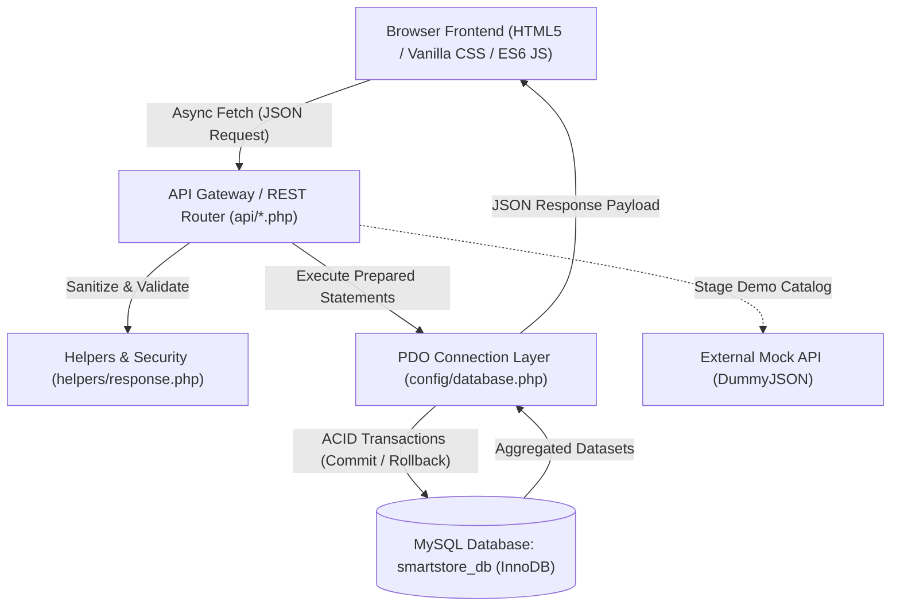
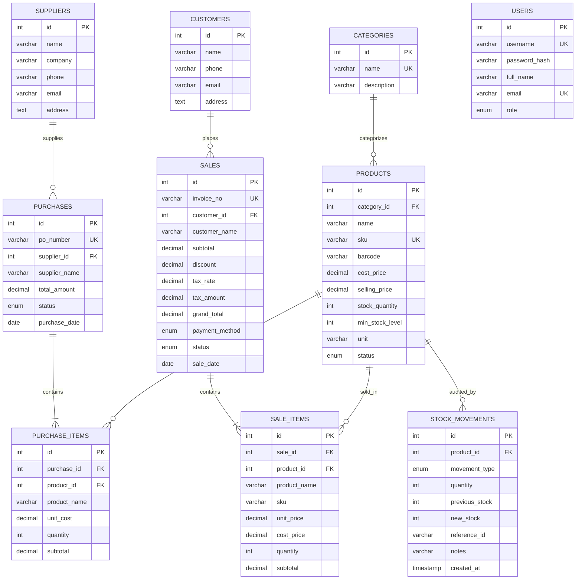

# SmartStore – Inventory & Sales Management System
### Full-Stack Web Technologies Project (Review 02 Evaluation)

## GitHub Pages: static demo

The dashboard can run from GitHub Pages at **`https://itsme-sagar.github.io/SmartStore/`**. The HTML, CSS, and JavaScript asset paths are relative to the repository root, so the project works under GitHub's `/SmartStore/` repository path without a root-domain rewrite.

GitHub Pages is a static host: it does not execute PHP, provide MySQL/MariaDB, or connect to a private database. On GitHub Pages the app automatically uses fictional sample records and a browser-side JavaScript data adapter. Product/customer/supplier edits, stock adjustments, restocks, and sales work as a demo and are saved in that browser's `localStorage` where available; they are not sent to a server, shared with other visitors, or suitable for real business records. Clearing this site's browser storage restores the original sample data. The static demo uses a built-in mock catalog and does not require an external API.

When served from GitHub Pages, the connection indicator reads **Static Demo**. For a local static preview, append `?demo=1` to the page URL. When served from XAMPP without that query, the existing PHP/MySQL backend remains the active data source. The PHP backend source is preserved, but its API routes are not available on GitHub Pages.

### PHP and database dependencies

The existing backend is PHP source, not a set of Pages-compatible serverless routes. It requires a PHP host with PDO's MySQL driver and a reachable MySQL/MariaDB database. The application uses these API endpoints:

| Endpoint | Purpose |
|---|---|
| `api/status.php` | PHP and database health/status |
| `api/products.php` | Product catalog CRUD, filtering, and sorting |
| `api/categories.php` | Product category data |
| `api/customers.php` | Customer CRM CRUD and purchase totals |
| `api/suppliers.php` | Supplier CRUD and purchase summaries |
| `api/sales.php` | Sales checkout, transaction history, and invoice details |
| `api/analytics.php` | Dashboard KPIs, chart data, alerts, and reports |
| `api/stock.php` | Stock changes and audit history |
| `api/purchases.php` | Supplier restocking transactions |
| `api/fake-api.php` | External catalog staging and product import (PHP mode) |
| `api/setup.php` | Local database setup and health checks |

Database connections are configured in `config/database.php` using environment overrides. Do not publish `.env` files, real credentials, production database exports, logs, backups, or private customer data. Database/schema and dump files are excluded by `.gitignore`.

### Enable GitHub Pages

1. Open the repository on GitHub and select **Settings**.
2. In the left sidebar, select **Pages** (under **Code and automation**).
3. Under **Build and deployment**, choose **Deploy from a branch**.
4. Set the branch to **`main`** and the folder to **`/ (root)`**, then click **Save**.
5. Wait for the Pages deployment to finish. Visit **`https://itsme-sagar.github.io/SmartStore/`**; GitHub also shows the published URL in **Settings → Pages**.

---

## 1. Student & Project Identification
- **Student Name:** Sagar Dhakal
- **Roll Number:** 24CS275
- **Department:** Computer Science and Engineering (BE CSE – IIIrd Year)
- **Course & Codes:** U21CS501 & U21CS504 – Web Technologies Theory and Lab
- **Evaluation Milestone:** Review 02 (Full-Stack Implementation with PHP, MySQL & REST APIs)
- **Local Development URL:** [http://localhost/SmartStore-Review02/](http://localhost/SmartStore-Review02/)
- **Review 01 Static Baseline (Archived):** [https://itsme-sagar.github.io/SmartStore/](https://itsme-sagar.github.io/SmartStore/)

---

## 2. Project Overview & Problem Statement

### 2.1 Problem Statement
Small-to-medium retail outlets and campus stores often struggle with fragmented inventory tracking, manual invoicing, and vulnerable client-only tracking tools. Review 01 demonstrated a pure front-end interface using browser `localStorage`. However, client-only persistence suffers from severe limitations:
1. Data vanishes upon clearing browser storage or switching machines.
2. Prices and discounts in the browser can be manipulated, introducing financial inaccuracies.
3. Lack of database transactions risks negative inventory and inconsistent billing records.
4. Absence of an audit log makes inventory shrinkage untraceable.

### 2.2 Objectives for Review 02
SmartStore Review 02 transforms the project into an enterprise-grade, transaction-safe, full-stack Retail SaaS application that:
- Establishes **MySQL (MariaDB)** as the authoritative single source of truth for all business data.
- Implements a modular **PHP 8.2 backend** using **PDO with prepared statements** to eliminate SQL injection.
- Enforces **ACID-compliant sales and restocking transactions** with row locking (`FOR UPDATE`) and automatic rollback on failure.
- Maintains an **immutable stock audit log** (`stock_movements`) tracking every item sale, restocking order, and manual adjustment.
- Provides a **modern, responsive SaaS UI** with purple & blue technology branding, dark/light theme, and live database connectivity status.
- Integrates an **External Mock/Fake API** staging portal (Requirement 11) allowing preview and verified import of external product catalogues into MySQL.

---

## 3. Technology Stack

| Layer | Technologies Used | Description & Purpose |
|---|---|---|
| **Frontend Core** | HTML5, CSS3, Vanilla JavaScript (ES6+) | Semantic layout, modern SaaS UI, async state management, zero external framework overhead |
| **Styling & Theme** | Vanilla CSS Design System | Custom properties, dark/light theme persistence, responsive flex/grid layouts, print stylesheet |
| **Backend API** | PHP 8.2.12 (CLI & Apache Handler) | RESTful JSON controllers, strict server-side validation, error handling and response formatting |
| **Database & ORM** | MySQL 10.4 / MariaDB (InnoDB Engine) | Normalized schema, foreign keys, cascading rules, decimal precision for currency, indexing |
| **Database Access** | PHP Data Objects (PDO) | Prepared statements, parameter binding, pessimistic row locking (`FOR UPDATE`), transaction rollback |
| **Visual Analytics** | CSS Custom SVG & Bar Visualizer | Dynamic database-driven 7-day revenue charts and inventory health donut breakdown |
| **External Mock API** | DummyJSON REST Service | External product catalogue feed integration for staged evaluation import |
| **Local Server** | Apache HTTP Server 2.4 (XAMPP) | Local server host serving on `http://localhost/SmartStore-Review02/` |

---

## 4. System Architecture



### Key Architectural Strengths:
1. **Decoupled API Design:** The front-end communicates with PHP purely over JSON endpoints (`api/*.php`).
2. **Never Trust Client Calculations:** Subtotals, discounts, taxes (5%), and grand totals are calculated and verified exclusively on the PHP server using live database prices.
3. **Pessimistic Concurrency Control:** When completing a sale, product rows are locked using `SELECT ... FOR UPDATE` to guarantee that concurrent sales cannot oversell stock or cause negative balances.

---

## 5. Relational Database Schema (`database/schema.sql`)

The database `smartstore_db` is normalized into 10 tables running on the InnoDB storage engine:



---

## 6. PHP Backend API Documentation

All endpoints set standardized CORS and JSON headers, return consistent response formats, and utilize appropriate HTTP status codes (200, 201, 400, 404, 409, 500, 503).

### Response Envelope Standard:
```json
{
  "success": true,
  "message": "Operation completed successfully.",
  "data": { ... },
  "timestamp": "2026-10-20T03:30:00+05:30"
}
```

### Endpoint Reference Table:

| Endpoint | Method | Purpose | Input Parameters / Body | Output / Behavior |
|---|---|---|---|---|
| `api/status.php` | `GET` | Health check & MySQL status | None | Returns DB connection status, latency, MariaDB version, table row counts |
| `api/products.php` | `GET` | List/filter products | `?search`, `?category`, `?stock_status`, `?sort`, `?id` | Enriched products with calculated `stock_status` ('healthy', 'low', 'out') |
| `api/products.php` | `POST` | Create product | JSON `{ name, sku, category, price, cost_price, stock, min }` | Validates duplicate SKU; creates initial stock movement; returns 201 Created |
| `api/products.php` | `PUT` | Update product | JSON `{ id, name, sku, category, price, stock, min }` | Updates product; if stock edited, journals `ADJUSTMENT` movement |
| `api/products.php` | `DELETE` | Delete or deactivate | `?id=X` or JSON `{ id }` | Soft-deactivates if sales exist; deletes if clean; returns confirmation |
| `api/sales.php` | `GET` | Fetch sales & invoices | `?invoice_no=INV-...` or `?limit=50` | Full invoice with itemized line items and totals |
| `api/sales.php` | `POST` | **Complete Transaction-Safe Sale** | JSON `{ customer, payment_method, discount, items: [{id, qty}] }` | Locks rows with `FOR UPDATE`; validates stock; recalculates subtotal, 5% tax, total; inserts sale + items; deducts stock; logs `SALE` movement; atomic rollback if stock insufficient |
| `api/purchases.php` | `GET` | List restocking orders | `?id=X` | Purchase orders history with items and supplier info |
| `api/purchases.php` | `POST` | **Supplier Restock Order** | JSON `{ supplier_id, items: [{product_id, quantity, unit_cost}] }` | Generates `PO-...`; increments stock in MySQL; logs `PURCHASE` movement |
| `api/stock.php` | `GET` | Movement audit trail | `?product_id=X`, `?limit=100` | Chronological audit log of all stock changes with previous/new stock |
| `api/stock.php` | `POST` | Quick stock adjustment | JSON `{ id, delta, new_stock, notes }` | Updates quantity by delta (+/- 1, 5) or absolute value; logs audit diff |
| `api/customers.php` | `GET` | List customers CRM | `?search=query`, `?id=X` | Aggregates orders count and lifetime `total_spent` from `sales` |
| `api/customers.php` | `POST` | Register customer | JSON `{ name, phone, email, address }` | Validates 10-digit phone; creates customer profile |
| `api/suppliers.php` | `GET` | List suppliers | `?search=query`, `?id=X` | Enriched with purchase orders count and total value sourced |
| `api/suppliers.php` | `POST` | Register supplier | JSON `{ name, company, phone, email, address }` | Stores vendor contact profile |
| `api/analytics.php` | `GET` | Dashboard & reports data | None | Aggregates total revenue, gross profit, inventory cost/retail value, 7-day sales trend, top 6 best-selling products, category distributions |
| `api/fake-api.php` | `GET` | Preview external mock API | None | Fetches external catalogue from DummyJSON; labels items as "External Demo" |
| `api/fake-api.php` | `POST` | Import mock item to MySQL | JSON `{ name, category, selling_price, stock_quantity, suggested_sku }` | Validates and inserts accepted demo item into real MySQL database |
| `api/setup.php` | `GET` | Check/initialize database | `?action=check` or `?action=init` | Verifies all 10 tables exist; runs `schema.sql` if tables absent |

---

## 7. Requirement 11 — External Mock / Fake API Integration

To fulfill the college evaluation syllabus requirement regarding Fake APIs without destabilizing real MySQL operations:
1. **Clear Segregation:** The internal core operations (Products, Sales, Restocks, Customers, Analytics) strictly run on our custom PHP REST APIs and MySQL.
2. **Staging Gateway:** The endpoint `api/fake-api.php` acts as an integration gateway consuming external sample catalog products from `https://dummyjson.com/products`.
3. **Demo Data Labeling:** When previewed in the UI via the **"Import from Mock API"** modal, staged external products are highlighted with an **"External Demo"** badge.
4. **Verified MySQL Ingestion:** Clicking **"Import to MySQL"** converts the mock item into a verified record, allocates a unique SKU, associates it with a category, and commits it into the `products` table in MySQL with an audit movement.

---

## 8. XAMPP Local Setup & Installation Guide

### Prerequisites
- Windows 10/11
- XAMPP installed (includes Apache 2.4, PHP 8.2+, MySQL / MariaDB 10.4+)

### Installation Steps

#### Step 1: Place Project in XAMPP `htdocs`
The project must be served from `C:\xampp\htdocs\SmartStore-Review02`.
If your workspace is located in another folder (e.g. `Documents\Coding is Life\SmartStore_Project`), create a directory junction:
```cmd
mklink /J "C:\xampp\htdocs\SmartStore-Review02" "c:\Users\sagar\Documents\Coding is Life\SmartStore_Project"
```

#### Step 2: Start Apache and MySQL in XAMPP
1. Open **XAMPP Control Panel**.
2. Click **Start** for **Apache**.
3. Click **Start** for **MySQL**.

#### Step 3: Import the Database Schema
Option A — Via phpMyAdmin (Web GUI):
1. Open your browser and navigate to `http://localhost/phpmyadmin/`.
2. Click **New** on the left sidebar and create a database named `smartstore_db` with collation `utf8mb4_unicode_ci`.
3. Select `smartstore_db`, click on the **Import** tab at the top.
4. Choose the file `C:\xampp\htdocs\SmartStore-Review02\database\schema.sql`.
5. Click **Import** at the bottom.

Option B — Via Terminal / Command Prompt:
```powershell
Get-Content "C:\xampp\htdocs\SmartStore-Review02\database\schema.sql" | & "C:\xampp\mysql\bin\mysql.exe" -u root
```

Option C — Via Auto-Setup Endpoint:
Visit `http://localhost/SmartStore-Review02/api/setup.php?action=init` in your browser.

#### Step 4: Verify Database Connection Config
Check `config/database.php`:
```php
define('DB_HOST', getenv('DB_HOST') ?: '127.0.0.1');
define('DB_PORT', getenv('DB_PORT') ?: '3306');
define('DB_NAME', getenv('DB_NAME') ?: 'smartstore_db');
define('DB_USER', getenv('DB_USER') ?: 'root');
define('DB_PASS', getenv('DB_PASS') !== false ? getenv('DB_PASS') : '');
```
*Default XAMPP configuration (`root` user with empty password) connects automatically.*

#### Step 5: Launch the Application
Open your browser and navigate to:
```
http://localhost/SmartStore-Review02/
```
The status badge in the top right will display **"MySQL Live"** and the sidebar will indicate **"MySQL Connected"**.

---

## 9. Automated Testing & Quality Assurance

SmartStore includes an automated PHP test runner executing 19 end-to-end integration tests.

### Running the Test Suite:
Run the following command in PowerShell:
```powershell
& "C:\xampp\php\php.exe" "C:\xampp\htdocs\SmartStore-Review02\tests\test_api.php"
```

### Test Suite Execution Output:
```text
=== SMARTSTORE REVIEW 02 - AUTOMATED TEST SUITE ===

Test 1: System Health & Database Connectivity
  [PASS] Status returns HTTP 200 and success=true
  [PASS] Status reports healthy database
  [PASS] Status reports MariaDB/MySQL

Test 2: Product Creation & Validation
  [PASS] Product created successfully with valid input
  [PASS] Duplicate SKU correctly rejected with error
  [PASS] Negative price correctly rejected

Test 3: Customer CRM CRUD
  [PASS] Customer created successfully

Test 4: Transaction Safety & Rollback on Insufficient Stock
  [PASS] Target product initial stock is 15
  [PASS] Excessive sale correctly rejected by server
  [PASS] Database stock remained intact at 15 after rollback

Test 5: Valid Sale Transaction & Automatic Stock Deduction
  [PASS] Valid sale succeeded and generated invoice
  [PASS] Stock automatically deducted in MySQL from 15 to 12
  [PASS] Stock movement audit row recorded with delta -3

Test 6: Supplier Restock & Stock Addition
  [PASS] Restock transaction succeeded with PO number
  [PASS] Stock replenished in MySQL from 12 to 22

Test 7: External Fake API Integration & Import
  [PASS] Fake API returned staged catalog feed
  [PASS] Staged item imported and saved into MySQL products table

Test 8: Database Analytics Real Aggregations
  [PASS] Analytics returns live summary metrics
  [PASS] Analytics 7-day chart contains 7 daily datapoints

============================================
TEST RESULTS: 19 PASSED, 0 FAILED
============================================
```

---

## 10. Manual Testing Checklist for Review 02 Viva

| Feature to Demonstrate | Step-by-Step Viva Action | Expected Result |
|---|---|---|
| **1. MySQL Connection Indicator** | Observe the top right badge and sidebar footer. | Displays green pulse and `MySQL Live (10.4.32-MariaDB)`. |
| **2. Add Product with Duplicate SKU** | Go to **Products** → Click **＋ Add Product** → Enter SKU `KB-101` (already used). | System displays error toast: *"SKU 'KB-101' already exists"*. |
| **3. Negative Price Validation** | Enter Price `-50.00` in the product modal. | HTML5 and server-side validation reject submission. |
| **4. POS Billing & Stock Deduction** | Go to **Sales & Billing** → Pick a product (e.g. Wireless Mouse, note stock: 7) → Add 2 to cart → Select Walk-in Customer → Click **Complete Sale**. | 1. Success toast appears.<br>2. Tax invoice `INV-...` modal opens with print button.<br>3. Product stock immediately decreases from 7 to 5 in MySQL.<br>4. Sale is recorded in MySQL `sales` table. |
| **5. Oversell Prevention & Transaction Rollback** | In POS, attempt to sell 999 units of any product. | Server rejects transaction with *"Insufficient stock"*; transaction rolls back cleanly with zero changes to inventory. |
| **6. Supplier Restock Order** | Go to **Inventory** → Click **Restock from Supplier** → Select supplier and quantity (e.g. +20) → Submit. | Stock increases by 20, PO number is generated, and a `PURCHASE` movement appears in the audit log. |
| **7. Stock Movement Audit Trail** | Click **Stock Audit Log** in the sidebar. | Displays chronological journal with timestamps, movement types (`SALE`, `PURCHASE`, `ADJUSTMENT`), and previous vs new stock balances. |
| **8. External Mock API Importer** | Go to **Products** → Click **Import from Mock API** → Review staged external products → Click **Import to MySQL**. | Item is saved directly to MySQL and appears in the product catalog. |
| **9. Real Business Analytics** | Go to **Reports** or look at the **Dashboard**. | 7-day sales chart, inventory valuation, and top-selling products update dynamically from MySQL without page reload. |
| **10. Dark Mode Switcher** | Click the theme button in the topbar. | Theme switches smoothly between light and dark mode; preference persists upon refresh. |

---

## 11. Security Measures Implemented
1. **SQL Injection Defense:** All queries with user-supplied input strictly utilize PDO prepared statements with parameterized `:placeholders` or `?`.
2. **Cross-Site Scripting (XSS) Prevention:** The frontend sanitizes all database output via the `esc()` escape helper (`htmlspecialchars` equivalent in JavaScript). Server-side inputs are stripped of tags.
3. **Financial Tampering Prevention:** Subtotals, 5% tax calculations, and final amounts submitted by the browser are discarded. The server fetches authoritative unit prices directly from the database and recalculates totals before committing.
4. **Safe Error Handling:** Database exceptions (`PDOException`) are logged privately into server error logs (`logs/error_YYYY-MM-DD.log`). User-facing messages return friendly diagnostic strings without leaking database credentials or internal query paths.

---

## 12. Viva Voce Questions & Answers (Web Technologies Lab)

**Q1: Why did you migrate from LocalStorage to MySQL in Review 02?**
> *Answer:* LocalStorage is client-side, browser-specific, and limited to ~5MB. It lacks transaction support, relational integrity, multi-user concurrency, and row-level locking. Migrating to MySQL with PHP PDO allows persistent, multi-client, ACID-compliant storage with relational foreign keys.

**Q2: What is an ACID transaction and where is it used in SmartStore?**
> *Answer:* ACID stands for Atomicity, Consistency, Isolation, and Durability. In SmartStore, checkout sales and restocking orders run inside `$db->beginTransaction()`. In a sale, inserting the sale header, inserting sale items, updating product stock, and writing the audit movement must all succeed together. If any item has insufficient stock, `$db->rollBack()` cancels all partial changes, preventing inconsistent data or negative inventory.

**Q3: Why use PDO instead of mysqli?**
> *Answer:* PDO (PHP Data Objects) offers a unified, object-oriented database abstraction layer supporting prepared statements, named parameters, robust exception handling (`PDO::ERRMODE_EXCEPTION`), and easy switching between database engines.

**Q4: How did you implement Requirement 11 (Fake APIs)?**
> *Answer:* The fake API integration is implemented in `api/fake-api.php` by consuming the external REST API from DummyJSON. To maintain database integrity, external items are staged in a demo preview modal with an "External Demo" badge. Only when the store manager clicks "Import to MySQL" is the data validated and saved into the MySQL `products` table.

---

## 13. File Manifest

```text
SmartStore_Project/
├── .env.example              # Environment variables template
├── README.md                 # Comprehensive project documentation
├── index.html                # Upgraded SaaS dashboard application shell
├── index.js                  # Frontend state management, async API client & UI renderer
├── style.css                 # Modern CSS design system (Light/Dark themes, SaaS UI)
├── api/
│   ├── analytics.php         # Real MySQL aggregated KPI & chart analytics
│   ├── categories.php        # Categories list & creation
│   ├── customers.php         # Customer CRM CRUD & spend metrics
│   ├── fake-api.php          # External Mock API gateway & MySQL importer
│   ├── products.php          # Products CRUD with search, filter, sort & stock audit
│   ├── purchases.php         # Supplier restock orders & stock increments
│   ├── sales.php             # Transaction-safe POS checkout & invoice view
│   ├── setup.php             # Auto database schema installer & health check
│   ├── status.php            # MySQL connection test & table metrics
│   ├── stock.php             # Quick stock adjustment & movement audit log
│   └── suppliers.php         # Suppliers CRUD & purchase summaries
├── config/
│   └── database.php          # PDO connection, credentials & health checker
├── database/
│   └── schema.sql            # Normalized 10-table MySQL InnoDB schema with seed data
├── helpers/
│   └── response.php          # JSON envelope formatting, CORS headers & error logger
├── tests/
│   └── test_api.php          # 19 automated integration tests
└── backup_review01/          # Original Review 01 codebase backup
    ├── README.md
    ├── index.html
    ├── index.js
    └── style.css
```

---

*Submitted for Web Technologies Theory (U21CS501) and Lab (U21CS504) Review 02 Evaluation.*  
**Sagar Dhakal · Roll No: 24CS275 · BE CSE – IIIrd Year**
